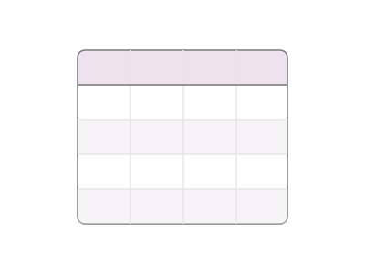
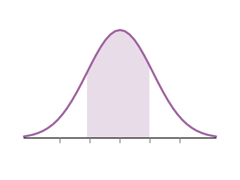
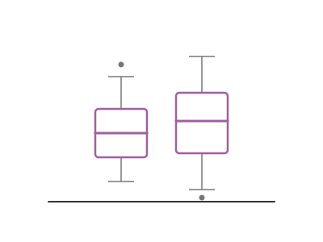
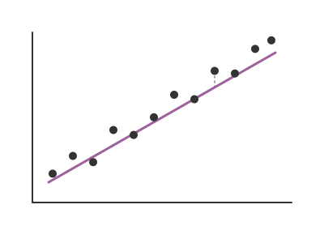

Practice statistical programming in R through short fill-in-the-blank exercises.

### Module 1

{.module-image}

**Working with Data**

Learning how to manipulate, summarize, and visualize data.

[**Data Wrangling →**](modules/module1/data_wrangling.qmd)

[**Data Summarization & Visualization →**](modules/module1/dataviz_summary.qmd)

### Module 2
{.module-image}

**Probability & Statistical Inference**

Explore probability distributions and sampling distributions using R.

- [Binomial Distribution →](modules/module2/binomial.qmd)
- [Normal Distribution →](modules/module2/normal.qmd)
- [Sampling Distributions →](modules/module2/sampling_distributions.qmd)

### Module 3
{.module-image}
**Comparing Groups**

Practice statistical tests for quantitative outcomes with 1-2 groups.

- [One-Sample t-Tests→](modules/module3/one_sample_t.qmd)
- [Wilcoxon Signed-Rank Tests→](modules/module3/wilcoxon_signed_rank.qmd)
- [Paired t-Tests→](modules/module3/paired_t.qmd)
- [Two-Sample t-Tests→](modules/module3/two_sample_t.qmd)
- [Wilcoxon Rank-Sum Tests→](modules/module3/wilcoxon_rank_sum.qmd)

### Module 4
{.module-image}

**ANOVA & Regression**

Practice statistical tests for quantitative outcomes with more than 2 groups or continuous predictors.

- [ANOVA & Kruskal-Wallis→](modules/module4/anova_kruskal_wallis.qmd)
- [Simple Linear Regression→](modules/module4/linear_regression.qmd)

### Module 5
{.module-image}
**Categorical Data**

Practice hypothesis tests for categorical variables.

- [Tests for One Proportion→](modules/module5/one_proportion.qmd)
- [McNemar's Test (Paired)→](modules/module5/mcnemars.qmd)
- [Chi-squared Tests→](modules/module5/chi_squared.qmd)
- [Fisher's Exact Test→](modules/module5/fishers_exact.qmd)

